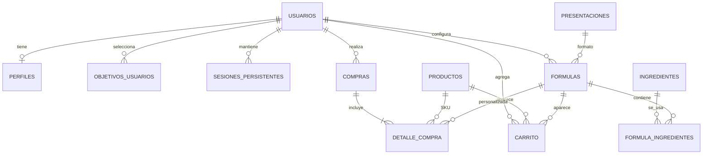

# crafted: Modelo relacional y pruebas de entrega

## Esquema de relaciones



**Clave:** cada `carrito` y `detalle_compra` se refiere a un `producto_id` **o** un `formula_id` (nunca a ambos). La compra conserva `nombre_snapshot` y `precio_unitario` para no perder información si cambia un producto después de venderse.

## Pruebas manuales sugeridas

1. Inicia la página, abre menú y catálogo desde móvil y escritorio. Verifica que todos los elementos se ajusten sin desbordamiento horizontal.
2. En phpMyAdmin, ejecuta `SELECT COUNT(*) FROM productos WHERE activo=1 AND cantidad_almacen>0;` → inicialmente debe devolver **35**.
3. Ejecuta `SELECT categoria,COUNT(*) FROM ingredientes GROUP BY categoria;` → bases **6**, sabores **8**, suplementos **10**, fibras **7**. `SELECT COUNT(*) FROM presentaciones;` → **4**.
4. Registra un usuario con correo válido y contraseña mayor o igual a 10 caracteres. Verifica que `usuarios.password_hash` **no** contenga la contraseña en texto claro.
5. Cierra sesión e inicia de nuevo con correo y contraseña. Prueba “mantener sesión iniciada”.
6. Completa el cuestionario con peso, estatura, actividad y al menos un objetivo. Verifica `perfiles` y `objetivos_usuarios`.
7. Ve a recomendaciones y usa el botón de personalización. Comprueba que al cambiar base, sabor, suplementos, fibra o presentación el precio del resumen cambia.
8. Intenta exceder el máximo de uno de los ingredientes a través de un POST: el servidor debe rechazar el guardado (no basta con una validación visual).
9. Agrega un producto de catálogo (cantidad 2), actualízala a 3 y elimina otro producto. Comprueba cambios en tabla `carrito`.
10. Antes de comprar: `SELECT cantidad_almacen FROM productos WHERE id=1;`. Finaliza compra simulada. Consulta nuevamente; el valor debe bajar en la cantidad adquirida.
11. Verifica un registro en `compras`, sus detalles en `detalle_compra`, las filas visibles en “Mis compras” y carrito vacío.
12. Prueba comprar más de las existencias: la compra no debe completarse y el inventario no debe quedar negativo.
13. Compra una fórmula; verifica que los gramos disponibles en `ingredientes.stock_gramos` disminuyan de acuerdo a `(gramos/porción) × (porciones/presentación) × (unidades)`.
14. Inicia como administrador y abre el panel. Agrega un SKU nuevo con foto, fabricante, origen, precio y existencias. Edita el precio y el stock y comprueba el cambio en catálogo.
15. Verifica que un cliente no pueda acceder al panel de administrador (403). Verifica historial de ventas en admin.

## Consultas para mostrar al profesor

```sql
USE crafted;
SELECT COUNT(*) AS productos_disponibles
FROM productos WHERE activo=1 AND cantidad_almacen>0;

SELECT categoria, COUNT(*) AS opciones
FROM ingredientes GROUP BY categoria;

SELECT p.id, p.nombre, p.precio, p.cantidad_almacen, p.fabricante, p.origen
FROM productos p ORDER BY p.id;

SELECT c.id, u.nombre AS usuario, c.total, c.estado, c.creado_en
FROM compras c JOIN usuarios u ON u.id=c.usuario_id ORDER BY c.id DESC;

SELECT * FROM historial_compras ORDER BY id_compra DESC;
```

## Formulación y seguridad

Las cantidades máximas de `ingredientes.maximo_g` son topes de interfaz **ilustrativos** que deben reemplazarse por límites técnicos/regulatorios validados. No atribuir efecto médico ni declarar “100% orgánico” a ingredientes sin certificados. En el proyecto todas las compras se marcan `simulado`.
